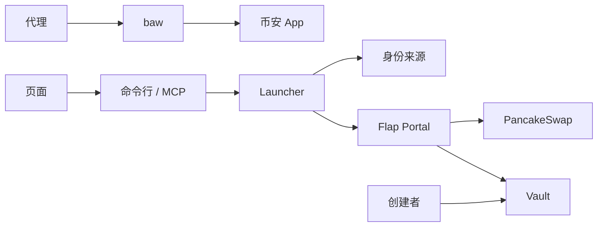

# 同价发射

代理用限价和预算参加新币开盘。窗口结束只清算一次，成交的人付同一个价。

## 问题

先到先得的曲线让第一笔和最后一笔差很多。用本机分叉演示场的 9 笔真实出价做模拟：同价的单价比是 1，常数乘积曲线是 1.7789，价差 0.00000875 BNB/枚。参数和算法在 [docs/why-uniform.md](docs/why-uniform.md)。这是模拟，不是行情。

同一区块里的顺序不影响清算价。一个身份只能出一笔。测试网的身份是替身，防女巫要等主网接上币安 Agent ID 真合约。

Agents submit a limit and a budget. One clearing at the end, one price for every fill. On the live demo bids, the uniform price ratio is 1 and a constant-product curve is 1.7789. Simulated, not market data.

## 评审直达

| 要求 | 证据 |
| --- | --- |
| Flap：用模板做发射界面 | [flap-ui/launcher-detail](flap-ui/launcher-detail) 和 [检查器输出](docs/flap-integration.md) |
| Flap：测试网完整发射 | [工厂](https://testnet.bscscan.com/address/0xE82642aC5c3B3B4b7D4cDeaf6a251Dc0BB7AcEfd)、[金库工厂](https://testnet.bscscan.com/address/0x2EF7a93b2fE4FBF520D5210b3ea39a72E5133dc6)。测试网还没开权限，本机分叉彩排在 [docs/e2e-evidence.md](docs/e2e-evidence.md) |
| Flap：Vault 按设计工作 | 分叉上金库增加 27516256919450703 wei，owner 提走相同数额，见 [证据](docs/e2e-evidence.md) |
| 机制为什么不同 | [docs/why-uniform.md](docs/why-uniform.md) |
| Developer：建在 BNB Chain | 链编号 97，合约已在 BscScan 验证 |
| 设计与可用性 | [架构和路径](docs/architecture.md)、[演示稿](docs/demo-script.md) |
| 技术实现 | [LICENSE](LICENSE)、[依赖](#依赖与致谢)、[.env.example](.env.example)、[docker-compose.yml](docker-compose.yml) |
| 创新 | [代理接口](agent/README.md)，命令行和 MCP，只给未签名交易 |
| 可持续 | [路线图](docs/roadmap.md)。协议现在不收费 |

Evidence links: Flap component, verified testnet contracts, local-fork rehearsal, agent interface, roadmap.

## 架构



页面只复制指令。签名在币安 App 里完成。结算成功后 Portal 建池，税进 Vault。

The page never signs. Settlement creates the pool through Flap. Tax sits in the vault.

## 合约

| 合约 | 地址 |
| --- | --- |
| 发射工厂 | [0xE82642aC5c3B3B4b7D4cDeaf6a251Dc0BB7AcEfd](https://testnet.bscscan.com/address/0xE82642aC5c3B3B4b7D4cDeaf6a251Dc0BB7AcEfd) |
| 金库工厂 | [0x2EF7a93b2fE4FBF520D5210b3ea39a72E5133dc6](https://testnet.bscscan.com/address/0x2EF7a93b2fE4FBF520D5210b3ea39a72E5133dc6) |
| Agent ID 来源 | [0xe4f7B9aBA67FEDAbF9B9a151C604466D448DAb09](https://testnet.bscscan.com/address/0xe4f7B9aBA67FEDAbF9B9a151C604466D448DAb09) |
| ERC-8004 来源 | [0x0526f00B99e952cE55F1B7BDaf9E6Ae42b42cf22](https://testnet.bscscan.com/address/0x0526f00B99e952cE55F1B7BDaf9E6Ae42b42cf22) |
| Portal | [0x000042108465206185A077Edc3F3fd2b49060000](https://testnet.bscscan.com/address/0x000042108465206185A077Edc3F3fd2b49060000) |

Addresses are the verified BSC testnet deployments. The factories are not enabled by Flap yet.

## 本机一条命令

```sh
bash script/demo.sh
```

跑完后终端打印页面地址和 `/?demo=1`。演示条有六幕，左右方向键切换，Esc 退出。

One command starts the local fork and the page, then prints both URLs. `docker-compose.yml` describes the same two processes. Docker was not run in this environment. `script/demo.sh` does not need it.

## 测试网

还没在测试网执行。Flap 没给工厂开权限，`create()` 会停下并打印原因。对着非本机 RPC 加 `--broadcast`，脚本拒绝。步骤和余额见 [docs/e2e-evidence.md](docs/e2e-evidence.md)。

Not executed on testnet. The script refuses a remote broadcast.

## 代理接口

```sh
node agent/cli.mjs status --launcher 0x… --rpc http://127.0.0.1:18545 --json
```

MCP 配置和一次真实调用在 [agent/README.md](agent/README.md)。给代理读的说明是 [web/public/llms.txt](web/public/llms.txt)。

The tools return unsigned transactions. The user confirms in the Binance app.

## 安全

不在网页、命令行或 MCP 里签名，也不广播。结算进入时剩余燃料低于 7000000 会在改状态前回滚，所以燃料上限用 8000000。身份在测试网是替身。

No signing and no broadcasting in the app, the CLI, or the MCP server.

## 商业模式

创建者拿走 100% 的税。协议现在不收费。以后可以选的收费点：创建费、结算费、或从税里分成。这些都还没做。

Creators keep 100% of the tax. The protocol charges nothing today. Future fees are options, not features.

## 路线图

黑客松后两周、主网前、主网后。见 [docs/roadmap.md](docs/roadmap.md)。没有日期承诺，也没有收入数字。

No dates and no revenue figures. See the roadmap.

## 依赖与致谢

- forge-std、OpenZeppelin、solady：合约测试和基础库，MIT
- Flap 接口和基类：来自 https://github.com/flap-sh/FlapPoolLaunchVaultExample ，按该仓库的许可证使用
- viem、React、Vite：页面和代理，MIT
- Geist 字体：SIL Open Font License

Dependencies are listed with the licenses we rely on.

## 许可证

[MIT](LICENSE)。版权人 Uniform Launch contributors。

MIT. Copyright Uniform Launch contributors.
