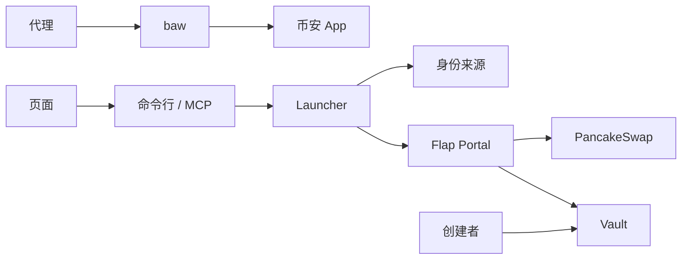

# 同价发射

基于 Agent ID 的 BNB Chain 同价发行协议：窗口结束一次清算，成功经 Flap 建池，失败全额退款。


代理用限价和预算参加新币开盘，窗口结束只清算一次，成交的人付同一个价。

## 问题

先到先得的曲线让第一笔和最后一笔差很多。用本机分叉演示场的 9 笔真实出价做模拟：同价的单价比是 1，常数乘积曲线是 1.7789，价差 0.00000875 BNB/枚。参数和算法在 [docs/why-uniform.md](docs/why-uniform.md)。这是模拟，不是行情。

同一区块内的出价顺序不影响清算价。每场分别按钱包地址和「身份来源＋编号」限制重复出价。测试网的 Binance Agent ID 使用替身。

Agents submit a limit and a budget. One clearing at the end, one price for every fill. On the live demo bids, the uniform price ratio is 1 and a constant-product curve is 1.7789. Simulated, not market data.

## 评审直达

| 要求 | 证据 |
| --- | --- |
| Flap：用模板做发射界面 | [flap-ui/launcher-detail](flap-ui/launcher-detail) 和 [检查器输出](docs/flap-integration.md) |
| Flap：测试网完整发射 | 公共测试网区块 144,926,064 已发射，4.45 tBNB 入池。[BscScan 发射回执](https://testnet.bscscan.com/tx/0x56d87f21c4dbd55227d9e619986555f150c7da5ddec5db663b201a9b9985ae20) · [拍卖、代币、池与 Vault](docs/public-testnet-evidence.md) |
| Flap：Vault 按设计工作 | 分叉上金库增加 27516256919450703 wei，owner 提走相同数额，见 [证据](docs/e2e-evidence.md) |
| 机制为什么不同 | [docs/why-uniform.md](docs/why-uniform.md) |
| Developer：建在 BNB Chain | 链编号 97。[发射工厂已验证](https://testnet.bscscan.com/address/0xE82642aC5c3B3B4b7D4cDeaf6a251Dc0BB7AcEfd) |
| BNB Chain 集成 | 同一份已验证工厂。页面和代理用 viem 读链 97，见 [llms.txt](web/public/llms.txt) |
| 设计与可用性 | [六幕截图与验收](qa/submission/README.md)、[演示稿](docs/demo-script.md) |
| 技术实现 | [LICENSE](LICENSE)、[依赖](#依赖与致谢)、[.env.example](.env.example)、[docker-compose.yml](docker-compose.yml) |
| 创新 | [代理接口](agent/README.md)，命令行和 MCP，只给未签名交易 |
| 可持续 | [路线图](docs/roadmap.md)。协议现在不收费 |

Evidence links: Flap component, verified testnet contracts, local-fork rehearsal, agent interface, roadmap.

## 架构



页面只复制指令。签名在币安 App 里完成。结算成功后 Portal 建池，税进 Vault。

The page never signs. Settlement creates the pool through Flap. Tax sits in the vault.

## 合约

| 合约 | 地址 |
| --- | --- |
| UniformLauncherFactory | [0xE82642aC5c3B3B4b7D4cDeaf6a251Dc0BB7AcEfd](https://testnet.bscscan.com/address/0xE82642aC5c3B3B4b7D4cDeaf6a251Dc0BB7AcEfd#code) |
| UniformVaultFactory | [0x2EF7a93b2fE4FBF520D5210b3ea39a72E5133dc6](https://testnet.bscscan.com/address/0x2EF7a93b2fE4FBF520D5210b3ea39a72E5133dc6#code) |
| AgentIdStandIn | [0x89c60E8E5aF13508900152e5FEE149bf5708d8a0](https://testnet.bscscan.com/address/0x89c60E8E5aF13508900152e5FEE149bf5708d8a0#code) |
| BinanceAgentIdSource | [0xe4f7B9aBA67FEDAbF9B9a151C604466D448DAb09](https://testnet.bscscan.com/address/0xe4f7B9aBA67FEDAbF9B9a151C604466D448DAb09#code) |
| Erc8004Source | [0x0526f00B99e952cE55F1B7BDaf9E6Ae42b42cf22](https://testnet.bscscan.com/address/0x0526f00B99e952cE55F1B7BDaf9E6Ae42b42cf22#code) |
| Portal | [0x000042108465206185A077Edc3F3fd2b49060000](https://testnet.bscscan.com/address/0x000042108465206185A077Edc3F3fd2b49060000) |

Addresses are the verified BSC testnet deployments. The pinned testnet snapshot and factory configuration are recorded in the E2E evidence.

## 前置

需要 Foundry、Node 22 或更高、python3、curl。Windows 先打开 WSL2，再跑下面的命令。分叉要能访问 `https://bsc-testnet-rpc.publicnode.com`。

装 Foundry：

```sh
curl -L https://foundry.paradigm.xyz | bash && foundryup
```

```sh
export PATH="$HOME/.foundry/bin:$PATH"
```

看 Node 版本（需要 22 或更高）：

```sh
node --version
```

看 python3 和 curl：

```sh
python3 --version
curl --version
```

第一次克隆带上子模块：

```sh
git clone --recurse-submodules https://github.com/Jimmycoding0301/uniform-launch.git
```

已经克隆过：

```sh
git submodule update --init --recursive
```

Foundry, Node 22 or newer, python3 and curl. On Windows, use WSL2. The fork reads `https://bsc-testnet-rpc.publicnode.com`.

## 本机一条命令

```sh
bash script/demo.sh
```

终端会打印本机演示地址。打开 `/?demo=1`，左右方向键切幕，Esc 退出。默认网页端口是 4317，遇到占用会自动选择空闲端口。脚本在 Anvil 生成或校验三个场次，并将地址写入 `web/public/demo.json`。

| 分叉演示场 | 可以核对的结果 |
| --- | --- |
| 接单 | 9 笔，提交预算 15.7 BNB，当前清算价 0.00002 BNB/枚，预计入池 10 BNB |
| 发射成功 | 开盘价 0.00008 BNB/枚，入池 40 BNB；买卖后的 Vault 余额从链上读取 |
| 未达门槛 | 三笔共 3 BNB，可清算但低于约 4.3357 BNB 的最低入池额，三人均可申请全额退款 |

从仓库根目录执行 `npm --prefix web test` 和 `forge test`。浏览器验收可使用已安装的 Google Chrome，也可先在 `web/` 中执行 `npx playwright install chromium`。本地演示复制只读预览指令。公开测试网场次使用 `/?network=testnet&launcher=<地址>`，填入代理钱包公开地址即可跟踪本次操作的回执。

Run the demo script to create and validate three local auctions. The printed URL follows the active web port. The public testnet view checks the Launcher’s factory and tracks the copied instruction against the sender, method and bid parameters.

## 测试网

2026 年 11 月 26 日，Uniform Launch 在 BSC 公共测试网（链 97）通过 Flap 完成发射。清算价为每枚 0.0000089 tBNB，实际入池 4.45 tBNB。发射交易为 [0x56d87f21c4dbd55227d9e619986555f150c7da5ddec5db663b201a9b9985ae20](https://testnet.bscscan.com/tx/0x56d87f21c4dbd55227d9e619986555f150c7da5ddec5db663b201a9b9985ae20)。

The auction launched through Flap at block 144,926,064 on BSC Testnet. One bid cleared at 0.0000089 tBNB per token and supplied 4.45 tBNB to the pool. [Public transaction receipts and contract addresses](docs/public-testnet-evidence.md) · [Local fork rehearsal and operator steps](docs/e2e-evidence.md)

## 代理接口

```sh
node agent/cli.mjs status --launcher 0x… --rpc http://127.0.0.1:18545 --json
```

先在 `agent/` 执行 `npm ci`。MCP 配置和一次真实调用在 [agent/README.md](agent/README.md)。给代理读的说明是 [web/public/llms.txt](web/public/llms.txt)。

Run `npm ci` in `agent/` first. The tools return unsigned transactions. The user confirms in the Binance app.

## 安全

不在网页、命令行或 MCP 里签名，也不广播。Foundry 脚本只在 RPC 主机名是本机时才允许广播。结算进入时剩余燃料低于 7000000 会在改状态前回滚，所以燃料上限用 8000000。身份在测试网是替身。

No signing and no broadcasting in the app, the CLI, or the MCP server. Forge scripts broadcast only when the RPC host is loopback.

## 已知限制

每场可配置一至四个身份来源。合约校验钱包和来源内的身份编号，并限制重复出价。测试网 Binance Agent ID 是替身。身份的唯一性取决于来源的发放规则。单人预设需准备 4.6 tBNB。

Each auction accepts one to four configured identity sources. A wallet and a source-specific identifier can each bid once. Identity uniqueness depends on the issuer. The testnet Binance Agent ID is a stand-in. The single-signer preset requires 4.6 tBNB.

## 商业模式

创建者拿走 100% 的税。协议现在不收费。以后可以选的收费点：创建费、结算费、或从税里分成。这些都还没做。

Creators keep 100% of the tax. The protocol charges nothing today. Future fees are options, not features.

## 路线图

黑客松后两周、主网前、主网后。见 [docs/roadmap.md](docs/roadmap.md)。没有日期承诺，也没有收入数字。

No dates and no revenue figures. See the roadmap.

## 依赖与致谢

- forge-std、OpenZeppelin、solady：合约测试和基础库，MIT
- Flap 接口和基类：来自 https://github.com/flap-sh/FlapPoolLaunchVaultExample ，按该仓库的许可证使用
- viem、React、Vite：页面和代理，MIT
- Geist 字体：SIL Open Font License

Dependencies are listed with the licenses we rely on.

## 许可证

[MIT](LICENSE)。版权人 Uniform Launch contributors。

MIT. Copyright Uniform Launch contributors.
