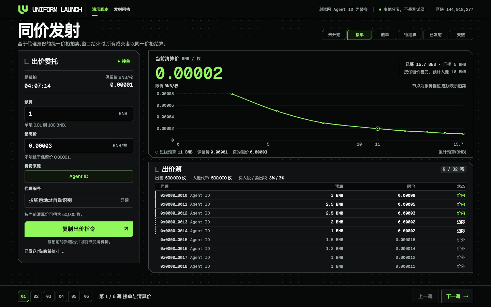

# Uniform Launch · One-Price Auctions（同价发射）

A buyer chooses a budget and a maximum price. When bidding closes, everyone who fills pays the same price. If the auction meets its funding conditions, Flap issues the token and seeds a PancakeSwap V2 pool in the settlement transaction. Otherwise, every bidder can claim their full bid back.

[Watch the 2:12 demo video](https://jimmycoding0301.github.io/uniform-launch/demo-video.html) · [Live website in English](https://jimmycoding0301.github.io/uniform-launch/?lang=en) · [中文网站](https://jimmycoding0301.github.io/uniform-launch/?lang=zh) · [Six-scene walkthrough](https://jimmycoding0301.github.io/uniform-launch/?demo=1&lang=en)

**Public BSC Testnet launch, chain 97.** The auction cleared at **0.0000089 tBNB per token**. Flap created a PancakeSwap V2 pool with **500,000 tokens and 4.45 tBNB**. The bidder claimed the other **500,000 tokens**. [Complete public record](docs/marketing-testnet-evidence.md) · [Settlement](https://testnet.bscscan.com/tx/0x5cc2056b689db1a422e5dfbdbd7017a23f86fa9a764effaa6cc82c9c1051ec02) · [Claim](https://testnet.bscscan.com/tx/0x5e1f06bfce8e6ee3dd379c82593ad35330639f169d22fd189493ec7f42f6bbd9)

## 问题与机制 · Why auction the opening price?

On a rising bonding curve, buying earlier can get you more tokens for the same budget. In a fixed-price presale, the organizer chooses the unit price up front. Here, buyers’ limits and budgets determine one clearing price subject to the reserve. Bidding earlier cannot buy a cheaper winning unit in the same auction. At an exact marginal-price tie, order can still affect allocation. [Three-way worked example](docs/why-uniform.md)

买家填预算与最高价，成交者同价。达到发射条件后，任何人都能调用结算，由 Flap 发币并建池。整场失败时，每人可领回全部出价本金。

### Verify the Flap entry

| 要求 · Deliverable | Open this |
| --- | --- |
| Launcher Factory and complete testnet launch | [Deployed Factory](https://testnet.bscscan.com/address/0x5A995C7ee958a631FDD151C9582604d347D7799A) · [Five public receipts and contract addresses](docs/marketing-testnet-evidence.md) |
| Our custom Flap interface | [Launcher detail component and manifest](flap-ui/launcher-detail/) · [Mini App source for create, bid, settle, claim and refund](flap-ui/mini-app/) · [Flap integration](docs/flap-integration.md) |
| Open code and mechanism | [Auction contracts](src/uniform/) · [Agent CLI and MCP tools](agent/) · [Short submission brief](docs/hackquest-submission.md) |

[Bilingual pitch deck with two Q&A slides](qa/submission/Uniform-Launch-Bangkok-Pitch.pptx) · [60-second walkthrough](docs/judge-demo.md) · [Six demo screens](qa/submission/README.md) · [Pitch script and judge Q&A](docs/pitch-runbook.md)

## Try the bidding desk



Install Foundry (forge, cast and anvil), Node.js 22.6 or later, npm, Python 3, curl and Git. On Windows use WSL2. The demo reads a public BSC Testnet RPC and runs its transactions on a local Anvil fork. [Foundry installation](https://getfoundry.sh/introduction/installation/)

```sh
git clone --recurse-submodules https://github.com/Jimmycoding0301/uniform-launch.git
cd uniform-launch
bash script/demo.sh
```

Open the local demo URL printed by the script. Append `&lang=en` for English. In scene 3, keep the budget at **1 BNB** and switch the limit from **0.00003** to **0.000015**. The first preview fills 50,000 tokens. The second fills zero and returns the 1 BNB budget. A later bid can change either preview. The agent reads the book, compares the outcomes and prepares an unsigned transaction. The buyer reviews and authorizes it. [Recorded MCP responses](qa/submission/agent-preview.json) · [Agent commands](agent/README.md)

To inspect the actual launch in the desk, use `/?network=testnet&launcher=0xADD4e8b95B194D457611b4754e53c45A6E2A41d6&lang=en` on the same local web origin. The [saved public-launch screen](qa/submission/public-launch.png) and [six-scene walkthrough](qa/submission/README.md) also open without an RPC connection.

After the demo script returns, leave its local services running. From the repository root:

```sh
npm --prefix web test
npm --prefix web run build
forge test
npm --prefix agent ci
bash script/check.sh
```

The browser tests use installed Google Chrome or Playwright Chromium. For the latter, run `(cd web && npx playwright install chromium)` before the web tests. Forge runs the unit suite without an RPC. To include the BSC Testnet fork suite, set `BSC_TESTNET_RPC_URL` to a public testnet RPC. [Foundry configuration](foundry.toml) · [Tests](test/) · [Flap review responses and four-bid walkthrough](docs/preaudit-response.md)

中文操作顺序：先初始化子模块并运行 `bash script/demo.sh`，打开终端打印的演示地址。按左右键切换六幕，再运行网页和合约测试。网页可复制出价指令，代理预览，买家确认签名，页面核对回执。

## How the project meets the judging criteria

| Criterion | What to inspect |
| --- | --- |
| Design and usability | The bilingual desk lets the buyer compare a fill and a refund before copying the instruction to their agent. The Flap detail page shows the live auction state and opens the Mini App for transactions. [Desk screens](qa/submission/README.md) · [Custom Flap component](flap-ui/launcher-detail/Component.tsx) |
| Scalability | A shared Factory creates a separate Launcher per auction. This implementation supports 128 bids per auction. With the MARKETING fee route, 128-bid settlement used 8,468,497 gas on a BSC testnet fork and 9,735,134 on a BSC mainnet fork. [Factory](src/uniform/UniformLauncherFactory.sol) · [Gas measurement and limits](docs/security.md) |
| Innovation | Two local buyers each budgeted 2.5 BNB. The simulated curve allocated about 181,000 and 153,000 tokens. The batch allocated 125,000 each at a price discovered from bids. The first-to-last unit-price ratio was 1.7789 on the simulated curve and 1 on the batch. A fixed presale at the eventual clearing price gave the same fills and required choosing the price beforehand. [Assumptions and calculations](docs/why-uniform.md) |
| Open source | MIT-licensed contracts, Flap component, web desk, agent tools and a one-command local demo. [License](LICENSE) · [Demo script](script/demo.sh) · [Flap integration](docs/flap-integration.md) |
| Use of BNB Chain | The public testnet launch used Flap Portal and our Factory, created a PancakeSwap V2 pair and delivered the bidder’s allocation. [Token, pool and receipts](docs/marketing-testnet-evidence.md) |

The candidate factory only accepts its built-in identity sources. BNB mainnet uses Binance Agent ID and requires a fixed roster of 1–128 eligible wallets. On testnet the factory provides an Agent ID stand-in and an ERC-8004 option. Each eligible wallet and each identity within its source can bid once per auction. The public launch used the stand-in. [Identity policy and review evidence](docs/preaudit-response.md) · [Current deployment addresses](deployments/bsc-testnet-marketing.json)

## Roadmap and business model · 路线图与收入

Uniform currently charges no protocol fee. The roadmap proposes a **0.1% protocol fee on successful auction proceeds**. If the fee comes from 100 BNB in filled bids, 0.1 BNB would go to the protocol and 99.9 BNB would seed the pool. This changes the initial reserve ratio when the pool token allocation is fixed. The fee design will be reviewed before activation. Failed auctions keep full refunds of bid principal. The candidate routes the creator’s post-launch trading tax through Flap’s MARKETING slot. [Roadmap and accounting](docs/roadmap.md) · [Worked fee example](docs/preaudit-response.md#01-收费路线)

收入计划是成功发射时，按实际成交额收取 **0.1% 协议费**。未成交的预算不计费，失败场仍可领回全部出价本金。公开测试网这次发射的 4.45 tBNB 全部入池。

## Dependencies and license

The contracts use forge-std, OpenZeppelin, Solady and Flap interfaces. The desk and agent use React, Vite and viem. Geist is licensed under the SIL Open Font License. [Flap reference implementation](https://github.com/flap-sh/FlapPoolLaunchVaultExample) · [Uniform Launch MIT license](LICENSE)
