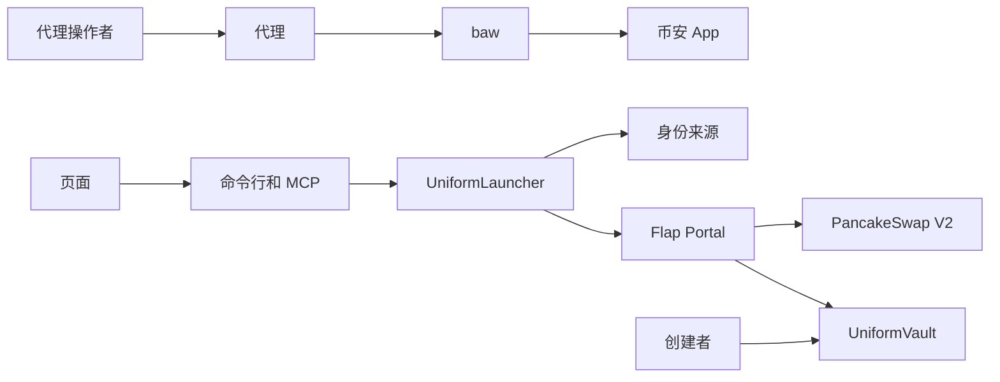
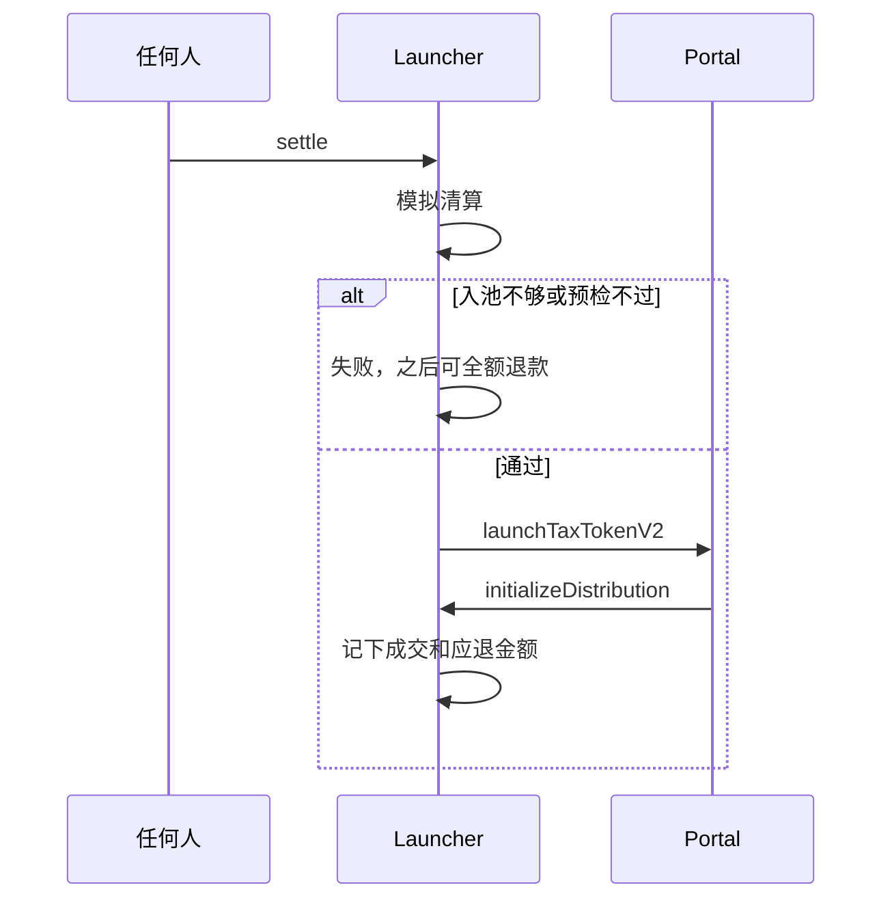
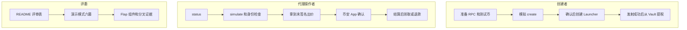

# 架构

## 系统组件

操作者把指令交给代理。代理只生成未签名交易。用户在币安 App 里确认。Launcher 核对身份，窗口结束后一次清算。Portal 建池并把税送进 Vault。创建者是 Vault 的 owner。

## 结算时序

模拟先算出清算价和每人的成交。新版读取 Portal 的报价、创建线和毕业线，取较高门槛，向上折算为 BNB，再加 0.05 BNB 流动性余量。入池低于门槛或未通过 Portal 的布尔预检时，可以全额退款。报价不可用时，结算回滚，保持拍卖状态等待重试。建池、分发和记账在一次调用内。剩余 gas 低于该场的 `MIN_SETTLE_GAS()` 时，结算在修改状态前回滚。

## 用户路径

三条路径互不代替。评委不用持有测试币。代理操作者不创建拍卖。创建者不替代理签名。
