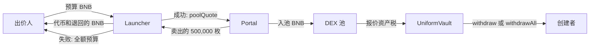

# 安全说明

这份说明只描述当前合约的权限、资金和已知风险。工厂被禁用后已创建的 Launcher 仍能发射，这是记录下来的行为，代码没有改。

不向活网发交易，不接触私钥，不把合约部署到服务器。脚本只有在 RPC 主机名正好是 `127.0.0.1` 或 `localhost` 时才广播。命令行和 MCP 只返回未签名交易，签名在币安 App 里完成。见 `agent/README.md`。

## 角色权限

| 角色 | 可以做 | 不可以做 |
| --- | --- | --- |
| 出价人 | 在窗口内 `bid` 一次；成功后 `claim`；失败后 `refund` | 第二次出价、改已提交的限价、领取别人的份额 |
| 任何人 | 窗口结束后调用 `settle`；随时 `preview` | 窗口没结束就结算；用低于该场 `MIN_SETTLE_GAS` 的剩余 gas 把一场成功拍卖打成失败 |
| 创建者 | 作为 Vault 的 owner 提取税款 | 改保留价、改清算价、拿走出价里的 BNB |
| Guardian | `guardianFail` 把未结算的场次打成失败；`withdrawAll` 只能把 Vault 余额转到 owner；升级 Launcher 实现 | 把税款提到自己的地址 |
| Portal | `newLauncher`；回调 `initializeDistribution`；收走入池的 BNB | 在 Launcher 的锁还开着时再插入一笔出价 |
| Vault owner | `withdraw` 到任意地址；`withdrawAll` 提到自己 | 动 Launcher 里的出价本金 |

`bid`、`settle`、`claim`、`refund`、`guardianFail` 和 `initialize` 共用 Launcher 上的一把锁。`withdraw` 和 `withdrawAll` 共用 Vault 上的一把锁。状态先改，再转 BNB 或代币。

## 资金流向

成功时，Launcher 先问 Portal `graduationFloorV2ForLauncher`。入池 BNB 低于毕业线，或这次调用失败，就进入失败态并全额退款，不调用 `launchTaxTokenV2`。达标之后才把 `poolQuote` 交给 Portal；若发射仍然 revert，同样进入失败态退款。每个人后来领走的退款，加上这份 `poolQuote`，不超过本场收进来的预算。代币分配数不超过 500,000 枚。领完之后 Launcher 的 BNB 和代币余额都大于等于 0。除不尽的代币留在 Launcher 里，没有提取函数。

失败时不调用 Portal。每个出价人拿回自己的预算。

## 舍入

清算价仍是 `预算合计 * 1e18 / 待售数量` 的向下取整。再向上取整会抬过边际那一笔的最高价，一场本来能成交的拍卖会变成失败，所以定价公式没有改。

分配偏向合约：

- 分到的代币按比例向下取整，余量不补给任何一笔出价。
- 边际成交的实付按 `代币 * 清算价 / 1e18` 向上取整，并且不超过该笔预算。退款是预算减去这份实付。
- 不变量：`代币合计 <= 待售数量`，`poolQuote + 退款合计 <= 预算合计`，并且每笔 `代币 * 清算价 <= 实付 * 1e18`。有效成交价不低于公布的清算价。

## 已知风险

### 工厂被禁用后，已经创建的 Launcher 仍能发射

`portal.setLauncherFactoryMultiplier(..., false)` 只挡住之后的 `newLauncher`。已经锁过 salt、正在接单的 Launcher 调用 `settle` 时，当前测试网 Portal 仍会完成 `launchTaxTokenV2`，不会因为工厂已禁用而回滚。`test_disabledFactoryFlag` 覆盖的就是这个结果。

风险：关工厂不能取消已经开着的拍卖。窗口结束后任何人都能结算，成功的话一半供应和成交的 BNB 会进池。

处理：要停一场已经创建的拍卖，在 `endBlock` 之前由 Guardian 对那一场调用 `guardianFail`。失败后出价人各自 `refund`，不会发射。不要把「禁用工厂」当成取消已创建场次的办法。这个行为按 Portal 的现状保留，合约里没有额外拦截。

### 舍入余量代币

新版结算记录销售配额中未分配的数量。成功状态下，任何人都能调用 `burnUnallocatedTokens()` 将该数量转入 `0x000000000000000000000000000000000000dEaD`。调用会先清零余量，失败时整笔调用回滚。参与者尚未领取的代币和 quote 都保持在合约中，持续可领。公开演示的旧 Launcher 使用原先的无出口规则。

### 结算 gas

公开测试网合约接受 32 笔出价，结算入口要求 7,000,000 gas。新版接受 128 笔，结算时按限价排序，归并排序在价格相同时沿用原有出价编号的顺序。计算边际价时先用累计预算排除不可能成交的档位，通过检查的档位沿用逐笔取整。两种办法避免为大量不同限价重复扫描整个出价簿。

在 BSC 测试网分叉的 `test_maxBidsSettleGas` 中，128 个钱包以递增的不同限价入场，成功发币、建池并验证末笔领取，测试测得结算调用消耗 **8,673,707 gas**。混合限价的满场测试也核对了部分成交、退款和余额守恒。新版的 `MIN_SETTLE_GAS` 为 13,000,000，客户端在链上读取该值并加 1,000,000 作为交易 gas 上限。BSC 单笔交易 gas 上限为 16,777,216。[测试代码](../test/Uniform.fork.t.sol) · [BEP-652](https://github.com/bnb-chain/BEPs/blob/master/BEPs/BEP-652.md)
